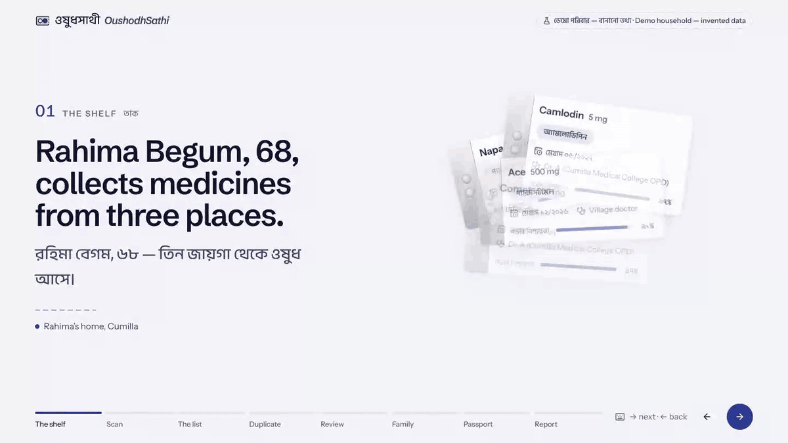
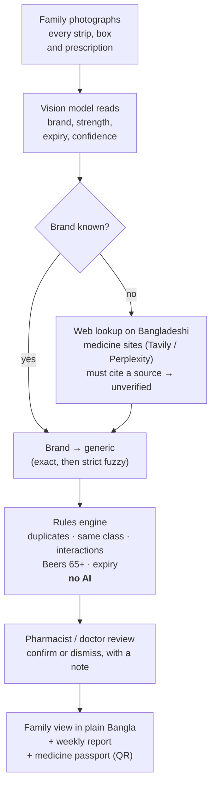
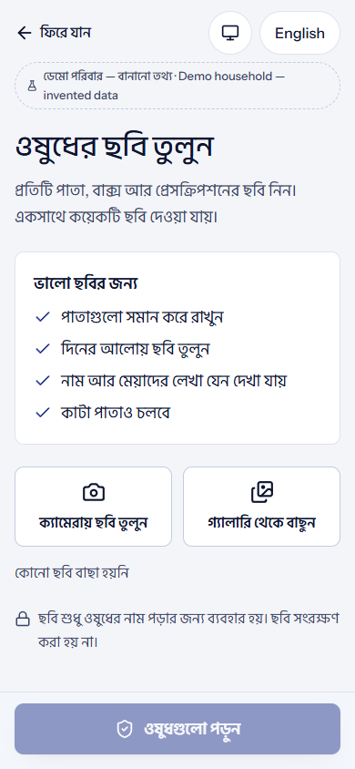
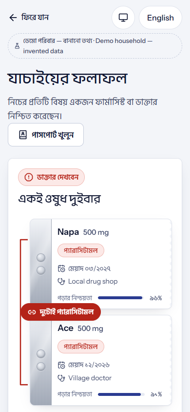
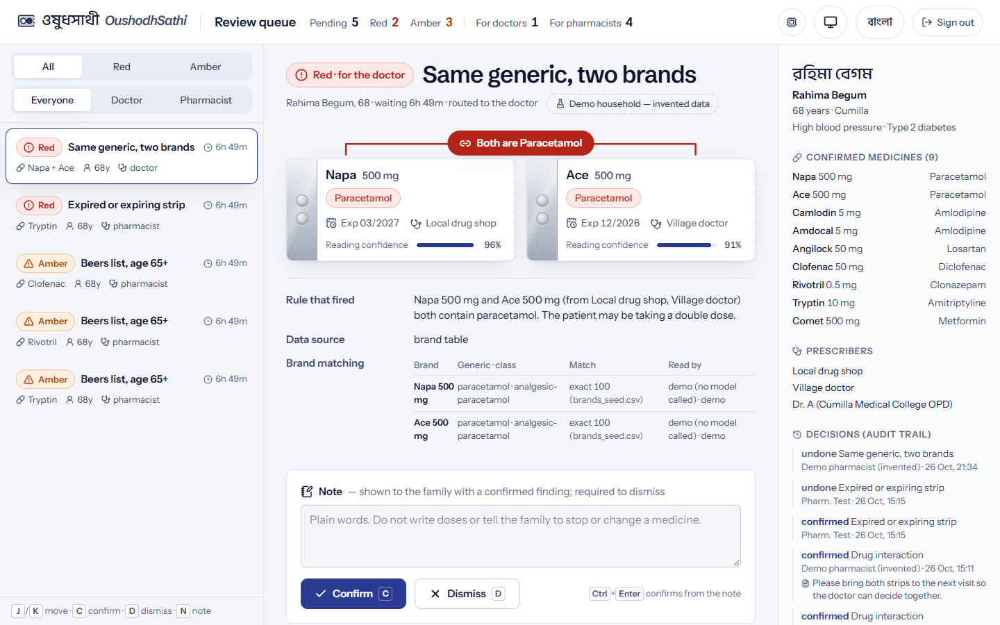
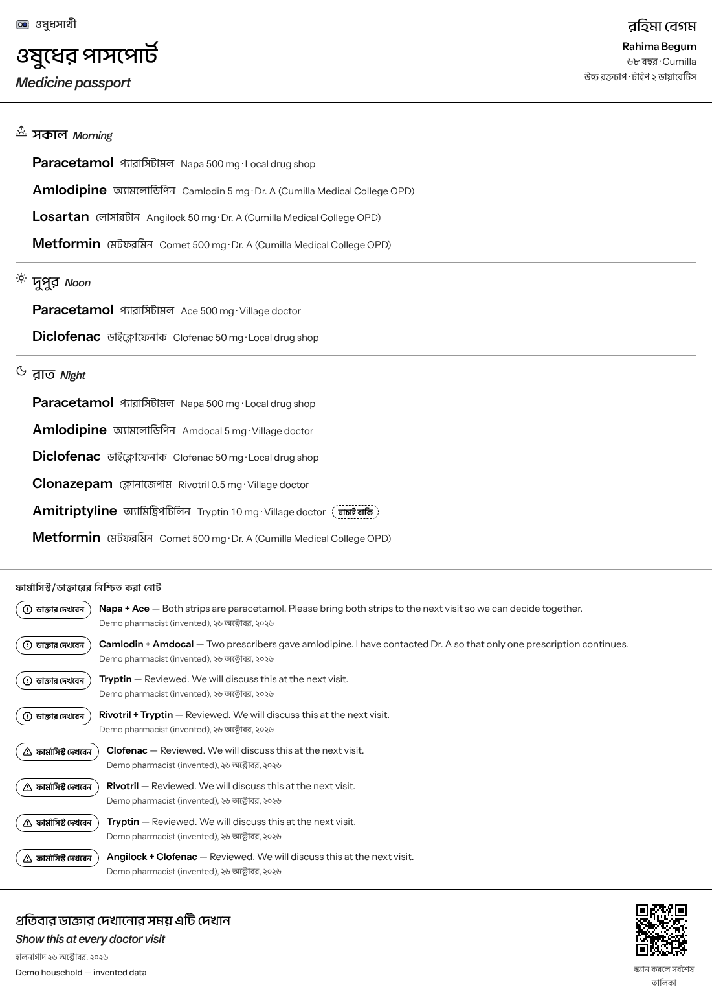
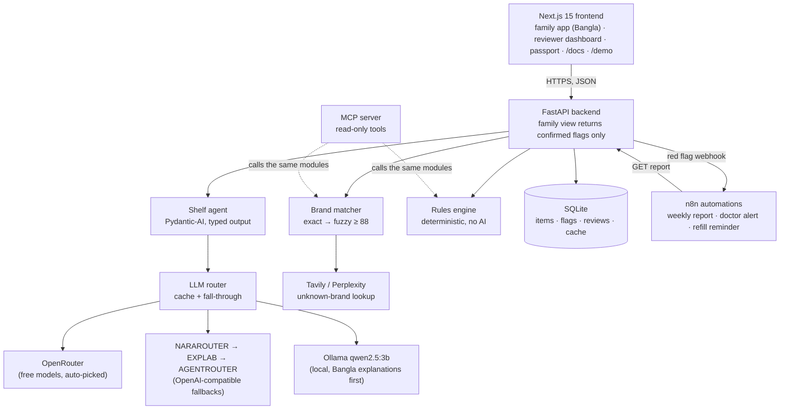

<picture>
  <source media="(prefers-color-scheme: dark)" srcset="docs/brand/banner-dark.svg">
  
</picture>

**A pharmacist for every elderly home in Bangladesh: we scan every medicine a parent takes, catch dangerous duplicates and interactions, and a clinician confirms every finding before the family sees it.**

[](https://github.com/ProttoyDip/OushodhSathi-/actions/workflows/ci.yml)
[](LICENSE)
[](backend/requirements.txt)
[](frontend/package.json)
[](#acknowledgements)

**Live demo:** _link added after deploy ([how](docs/DEPLOY.md))_ · **Docs:** the `/docs` page of the app · **Demo video:** _YouTube link added after upload_ · **Reviewer login:** the dashboard at `/review` asks for a name and the `REVIEWER_TOKEN` from `backend/.env` (the quick start sets it to `demo-reviewer`)

<p align="center">
  
</p>

---

## The problem

- **Hypertension is now the most common illness in Bangladesh**, at 78.28 per 1,000 people (BBS Health and Morbidity Status Survey 2025, reported by [BSS](https://www.bssnews.net/others/337437) and [The Daily Star](https://www.thedailystar.net/health/disease/news/hypertension-most-common-illness-country-4047686)).
- **Only 11% of people with hypertension had their blood pressure controlled** below 140/90, a background figure in the [WHO-HEARTS evaluation in Bangladesh (Heart, 2024)](https://heart.bmj.com/content/heartjnl/early/2024/07/16/heartjnl-2024-324253.full.pdf).
- **69% of geriatric outpatients were prescribed five or more medicines** in a small 2011 study of 35 patients at a private hospital ([Trends of prescribing for out-door geriatric patients](https://www.academia.edu/111376182/Trends_of_prescribing_for_out_door_geriatric_patients_in_a_private_hospital_of_Bangladesh)).

An elderly patient often collects medicines from a hospital outpatient doctor, a village doctor and the local drug shop. Each sees only their own prescription, and the same molecule is sold under many brand names, so nobody notices that **Napa** and **Ace** are both paracetamol, or that two doctors have each started amlodipine.

## How it works



Anything read with under 0.75 confidence, and every web-found brand match, is shown to a human for confirmation before it enters the list.

Every page has a **Bangla ⇄ English** switch and a **light / dark** switch. The family app is built for a phone first and spreads into a working desktop layout on a laptop; the reviewer dashboard collapses into Queue / Evidence / Patient tabs on small screens.

## Screenshots

<table>
  <tr>
    <td width="50%"></td>
    <td width="50%"></td>
  </tr>
  <tr>
    <td><b>Scan (family, phone).</b> Bangla first, one action per screen, tips for cut strips and glare.</td>
    <td><b>Confirmed result (family, phone).</b> Only clinician-confirmed findings appear, in plain Bangla.</td>
  </tr>
  <tr>
    <td></td>
    <td></td>
  </tr>
  <tr>
    <td><b>Reviewer dashboard (desktop).</b> Evidence side by side; J/K to move, C to confirm, D to dismiss, N to add a note.</td>
    <td><b>Medicine passport (print).</b> Grouped by time of day, carried to every doctor visit.</td>
  </tr>
</table>

All screenshots use the invented demo household of Rahima Begum, 68, Cumilla.

## Why it's safe

**AI for perception, rules and humans for judgement.** Models read photos and write explanations; they never decide what is dangerous.

1. **Rules make every finding.** Safety flags come only from the deterministic engine in [`backend/app/rules.py`](backend/app/rules.py). Language models never create, remove or change the severity of a flag.
2. **A clinician confirms before the family sees anything.** Flags start as `pending_review`. The family view of the API returns only `confirmed` flags, enforced in the API, not just the UI, and covered by a test.
3. **No instruction to stop or change a medicine.** No text tells a patient to stop, start or change a medicine or dose. Explanations are checked for doses and stop-words and end with a fixed safety sentence.
4. **Uncertain readings are marked.** Extractions under 0.75 confidence and web-found brand matches are always shown as needing human confirmation.
5. **Names stay out of models.** Only medicine photos and medicine names are sent to a model, never patient names or phone numbers.
6. **Photos are not kept.** Photos are processed in memory and discarded after extraction.

These rules live in [`AGENTS.md`](AGENTS.md) and bind every coding agent that works on this repository.

## Architecture



SQLite is enough for the prototype and lives on a persistent disk when deployed ([`render.yaml`](render.yaml)).

## AI approach

| Task | Model / provider | Why | Guardrail |
| --- | --- | --- | --- |
| Read photos of strips, boxes, prescriptions | Free OpenRouter vision models, auto-picked (price 0, image input, largest context) and each **tested with a one-token call before use**; up to three, then `openrouter/free`, then NARAROUTER → EXPLAB → AGENTROUTER | Cut strips, glare and Bangla text need a vision model; free models keep it affordable | Typed Pydantic output, one retry, then needs-review; confidence < 0.75 always shown for a human check |
| Unknown brand → generic | Tavily search restricted to medex.com.bd, arogga.com, medeasy.health + a text model; Perplexity Agent API (`effort: fast`) as fallback | Bangladesh has tens of thousands of brands; a seed table cannot hold them all | Must cite a numbered search result; stored as `web_unverified` with the source URL; failures are never cached |
| Bangla explanation of a confirmed finding | Ollama `qwen2.5:3b` locally first, cloud fallback, then fixed templates | Private and free when run locally | Only for confirmed flags; dose and stop-word filter; Bangla well-formedness check (a broken vowel sign sends it back to the template); fixed safety sentence |
| Safety findings | **No model.** Deterministic rules | Judgement must be repeatable and auditable | Pure functions with tests; a clinician confirms every flag |

**When a provider runs out, the next one answers.** Every request walks a chain: the user's chosen model first (if any), then the tested free OpenRouter models, then the other configured routers, then Ollama on the machine. Rate limits (429), exhausted credit (402), withdrawn models, server errors and timeouts all fall through to the next link; nothing has to be switched by hand. Web lookup does the same with Tavily, then Perplexity.

**The models in use are visible, and the user can choose.** The **AI models** page (`/models`) shows each task's chain in order, which model answered last, and a picker to put a preferred model first; the rest stay as backups. The family's confirm screen says which model read the photos, and the reviewer sees the model and prompt version for every item.

Prompts are versioned files: [`extract_strip.v1`](backend/app/prompts/extract_strip.v1.md), [`brand_lookup.v1`](backend/app/prompts/brand_lookup.v1.md), [`explain_bn.v1`](backend/app/prompts/explain_bn.v1.md). Changing a prompt means a new version file and a new eval run.

## Evaluation

- **Extraction accuracy: evaluation in progress.** [`eval/run_eval.py`](eval/run_eval.py) scores the vision model against labelled photos of real Bangladeshi strips (cut strips, Bangla text, blur) and writes `eval/results_<prompt>.json`. No results have been recorded yet, so no accuracy number is claimed here. See [`eval/README.md`](eval/README.md) to add photos.
- **Pilot: not started.** Each consenting household becomes one row in [`eval/pilot.csv`](eval/pilot.csv); the `/docs` page reports proportions with 95% Wilson confidence intervals from that file only. Demo data is never counted.
- **Tests: 53 passing** (`pytest` in `backend/`), covering the rules engine, the family-view safety gate, router fallback and free-model probing, model choice, the explanation and Bangla-quality guards, and the statistics. CI runs them on every push, with the frontend lint and build.

## Tech stack

| Layer | Tools |
| --- | --- |
| Frontend | Next.js 15 (App Router), React 19, TypeScript, Tailwind CSS 4, next-intl (Bangla + English), motion, Recharts, lucide-react |
| Backend | Python 3.12+, FastAPI, Pydantic 2, Pydantic-AI, RapidFuzz, httpx, SQLite |
| AI | OpenRouter (free models), OpenAI-compatible fallback routers, Ollama (`qwen2.5:3b`), Tavily, Perplexity Agent API |
| Automation | n8n workflows (JSON in [`automations/`](automations)) |
| Agent interface | MCP server on the official `mcp` Python SDK |
| Testing and CI | pytest, ESLint, GitHub Actions |
| Hosting | Render (API, persistent disk) and Vercel (frontend), see [`docs/DEPLOY.md`](docs/DEPLOY.md) |

## Quick start

You need Python 3.12+, Node.js 20+ and git. The commands are for macOS / Linux; on Windows use `.venv\Scripts\` instead of `.venv/bin/`.

```bash
git clone https://github.com/ProttoyDip/OushodhSathi-.git
cd OushodhSathi-

# 1. Backend
cd backend
python3 -m venv .venv
.venv/bin/pip install -r requirements.txt
cp .env.example .env
sed -i.bak 's/^REVIEWER_TOKEN=.*/REVIEWER_TOKEN=demo-reviewer/' .env   # or edit .env by hand
.venv/bin/python scripts/seed_demo.py          # the invented demo household
.venv/bin/uvicorn app.main:app --port 8000     # API docs at http://localhost:8000/docs
```

```bash
# 2. Frontend, in a second terminal
cd OushodhSathi-/frontend
cp .env.example .env.local                     # NEXT_PUBLIC_API_URL=http://localhost:8000
npm ci
npm run dev                                    # http://localhost:3000
```

Open <http://localhost:3000> for the landing page, `/p/1` for the family app, `/review` for the reviewer dashboard (token `demo-reviewer`), `/models` for the AI models in use and `/demo` for the keyboard-paced walkthrough.

With `DEMO_MODE=true` (the default) everything works without API keys. To read real photos, add your own keys to `backend/.env` (an OpenRouter key is enough). **Never commit `.env`.**

Optional, for private Bangla explanations on your own machine:

```bash
ollama pull qwen2.5:3b
```

Run the checks the CI runs:

```bash
cd backend && .venv/bin/python -m pytest
cd frontend && npm run lint && npm run build
```

## Project structure

```
backend/       FastAPI API, deterministic rules engine, brand matching, AI layer, pytest suite
  app/prompts/ versioned LLM prompts (<name>.v<N>.md)
  data/        demo brand, interaction, Beers and duplicate-class tables
  scripts/     seed_demo.py, import_brands.py, import_ddinter.py
frontend/      Next.js app: family app, reviewer dashboard, passport, /docs, /demo
mcp/           read-only MCP server for Claude Desktop and other MCP clients
automations/   n8n workflows: weekly report, doctor alert, refill reminder
eval/          extraction eval set and script, pilot data (real households only)
docs/          deployment guide, brand assets, screenshots, video assets
video/         1920×1080 title scenes for the demo video
```

## MCP server

[`mcp/server.py`](mcp/server.py) is a stdio [Model Context Protocol](https://modelcontextprotocol.io) server that lets an MCP client use the product's medicine logic. All three tools are read-only; they can never write a flag.

| Tool | What it does |
| --- | --- |
| `match_brand(brand)` | Maps a Bangladeshi brand to its generic and class (exact, then strict fuzzy). "Napa Extra" is never forced onto "Napa". |
| `lookup_unknown_brand(brand, strength)` | Searches Bangladeshi medicine sites (Tavily, then Perplexity), must cite a source, always marked `web_unverified`. Needs a key in `backend/.env`. |
| `check_medicines(items, age)` | Runs the deterministic rules on a list and returns findings marked "pending clinician review". |

Claude Desktop config (Settings → Developer → Edit config), with your own absolute paths:

```json
{
  "mcpServers": {
    "oushodhsathi": {
      "command": "/path/to/OushodhSathi-/backend/.venv/bin/python",
      "args": ["/path/to/OushodhSathi-/mcp/server.py"],
      "env": { "PYTHONIOENCODING": "utf-8" }
    }
  }
}
```

More in [`mcp/README.md`](mcp/README.md).

## Roadmap

1. A pharmacist-verified brand table, replacing the demo seed with a licensed Bangladeshi drug database.
2. Full DDInter 2.0 interaction import, reviewed for medicines common in Bangladesh.
3. Partner pharmacies as scan points for families without a smartphone.
4. Bangla voice check-ins for blood pressure and doses.
5. A pilot with families, with results published only once they are real.

## Team

| Name | Role | GitHub |
| --- | --- | --- |
| _[Team member 1]_ | _[Role]_ | _[@handle]_ |
| _[Team member 2]_ | _[Role]_ | _[@handle]_ |
| _[Team member 3]_ | _[Role]_ | _[@handle]_ |

Mentor: _[NRB mentor, if any]_

## Data and licences

- **Code:** MIT, see [`LICENSE`](LICENSE).
- **DDInter 2.0** drug–drug interaction database, [CC BY-NC-SA 4.0](https://creativecommons.org/licenses/by-nc-sa/4.0/). Used for non-commercial prototype purposes with attribution; [`backend/scripts/import_ddinter.py`](backend/scripts/import_ddinter.py) imports its downloads. The repository ships only a small curated interaction seed.
- **AGS Beers Criteria** (American Geriatrics Society) as the clinical reference for the 65+ rules in [`backend/data/beers_seed.csv`](backend/data/beers_seed.csv).
- **"Medicinal Products in Bangladesh — A Dataset of Generic and Brand Names, Dosage Strengths, and Manufacturers"**, Md Mahmudur Rahman and Md M Khan, University of Dhaka, Mendeley Data, v1, 2024, [doi:10.17632/zhtvkny53n.1](https://data.mendeley.com/datasets/zhtvkny53n/1). Not redistributed here; [`backend/scripts/import_brands.py`](backend/scripts/import_brands.py) converts a local download, under the licence stated on the dataset page.
- **Brand seed** [`backend/data/brands_seed.csv`](backend/data/brands_seed.csv): demo data, **not pharmacist-verified**.
- **Fonts:** Schibsted Grotesk, Anek Bangla, Instrument Sans and Hind Siliguri, all under the SIL Open Font License.

## Medical disclaimer

OushodhSathi is a research prototype, not a medical device. It does not give medical advice. All findings must be confirmed by a registered pharmacist or doctor. Demo data is invented.

## Acknowledgements

Built for the **International AI Builders Congress 2026** (HealthSphere AI → ChronicCare AI), with thanks to **CloudCamp Bangladesh** and **Daffodil International University**.

See also [`CONTRIBUTING.md`](CONTRIBUTING.md) and [`SECURITY.md`](SECURITY.md).
