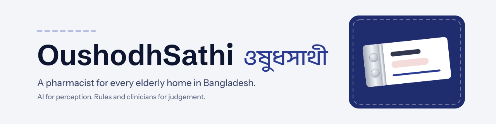
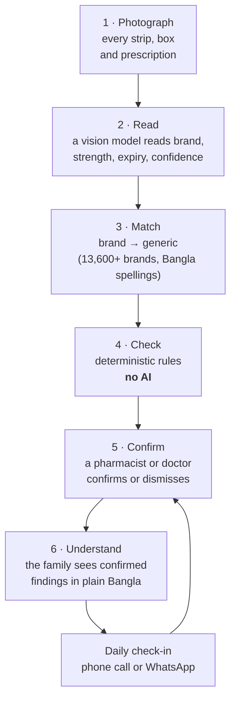
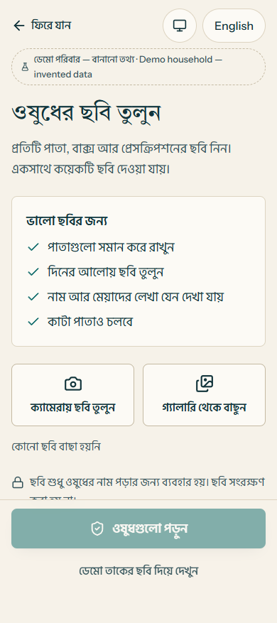
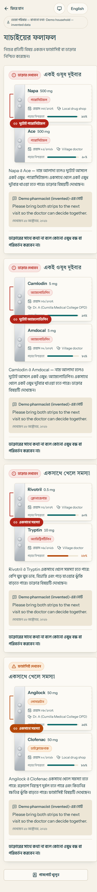
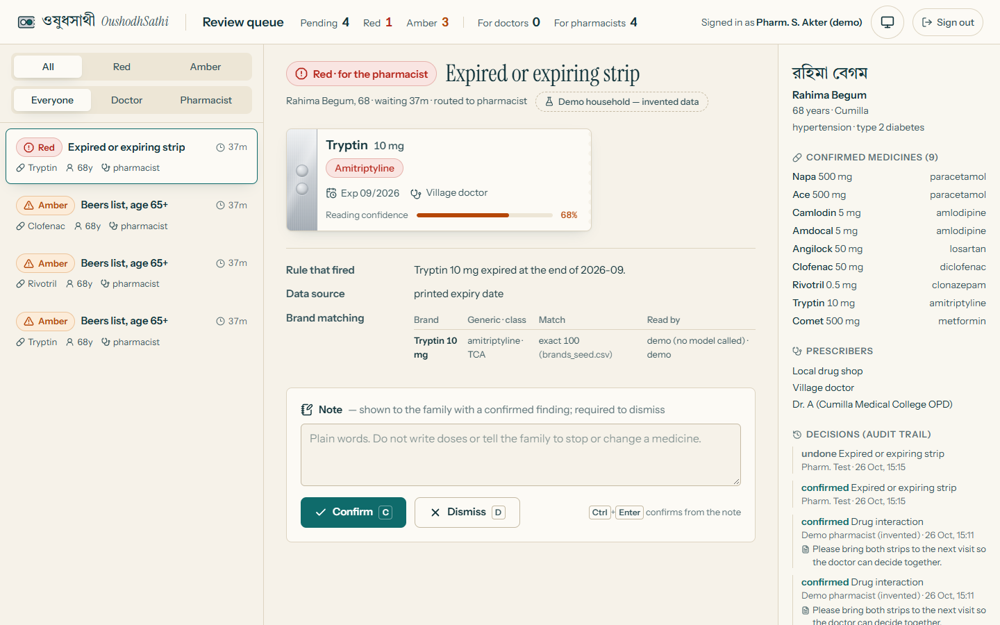
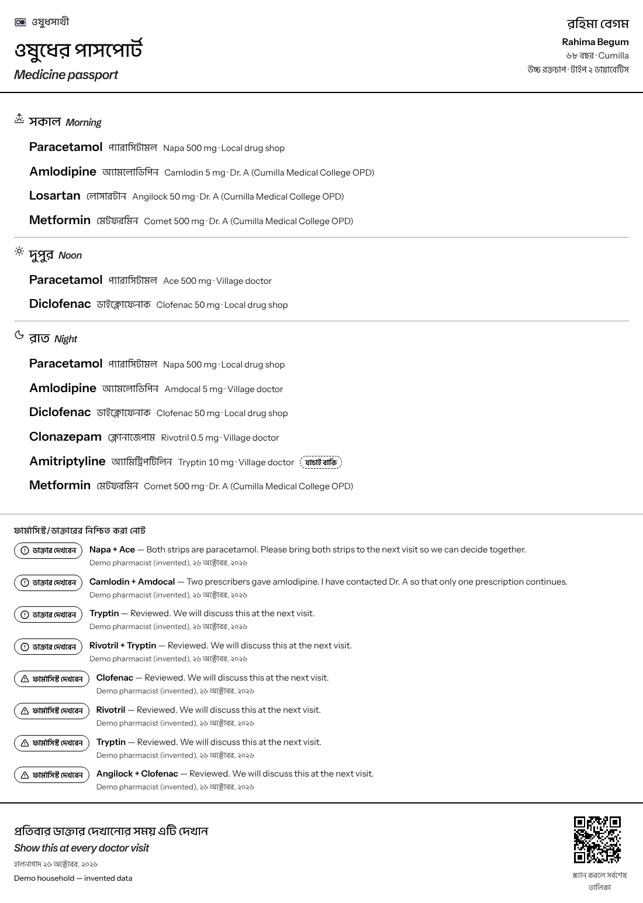

<picture>
  <source media="(prefers-color-scheme: dark)" srcset="docs/brand/banner-dark.svg">
  
</picture>

<p align="center"><b lang="bn">প্রতিটি বয়স্ক মানুষের ঘরে একজন ফার্মাসিস্ট</b><br><sub>"A pharmacist in every elderly person's home"</sub></p>

**A pharmacist for every elderly home in Bangladesh.** A family photographs every medicine in the house; AI
reads the strips; a fixed set of safety rules finds the same medicine twice, risky combinations and expired
strips; and a registered pharmacist or doctor confirms every finding before the family sees it, in plain Bangla.

[](https://github.com/ProttoyDip/OushodhSathi-/actions/workflows/ci.yml)
[](LICENSE)
[](backend/requirements.txt)
[](frontend/package.json)
[](docs/EVALUATION.md#6-software-tests)
[](#acknowledgements)

| | |
| --- | --- |
| **Live app** | <https://oushodhsathi.vercel.app> (English and Bangla; switch at the top right) |
| **Guided walkthrough** | [/demo](https://oushodhsathi.vercel.app/demo): the whole story, step by step with the arrow keys, on an invented household |
| **Demo video** | [YouTube](https://youtu.be/a3wnCDDxxm0) |
| **Live numbers** | [/docs](https://oushodhsathi.vercel.app/docs): evaluation results, served from the results files |
| **Reviewer dashboard** | [/review](https://oushodhsathi.vercel.app/review): judges receive a reviewer token in the submission's Judge Access Note |
| **Try it yourself** | [/start](https://oushodhsathi.vercel.app/start) creates a private household that opens only with its own link |

The API runs on a free hosting plan and sleeps when idle, so the first request can take up to a minute.

<p align="center">
  
</p>

**Contents:** [In 30 seconds](#in-30-seconds) · [A 3-minute tour](#a-3-minute-tour-for-judges) · [Why Bangladesh](#why-bangladesh-needs-this) · [How it works](#how-it-works) · [Results](#measured-results) · [Safety](#safety-by-design) · [Features](#whats-inside) · [AI](#ai-used-carefully) · [Architecture](#architecture) · [Quick start](#quick-start) · [Docs](#documentation) · [Limitations](#limitations) · [Roadmap](#roadmap) · [Team](#team)

## In 30 seconds

- **The problem.** Older people in Bangladesh collect medicines from several prescribers and shops, and the
  same medicine is sold under many brand names. Nobody sees the whole shelf, so double doses and risky
  combinations go unnoticed.
- **What we built.** A Bangla-first web app that turns photos of a household's medicines into one checked list,
  with a pharmacist or doctor confirming every safety finding.
- **How we use AI.** Models *read*; deterministic rules *judge*; people *decide*. No model can create, remove or
  grade a safety finding.
- **Where it stands.** Live and working end to end. Brands read correctly on **35 of 40 real medicine photos
  (88%)**. **444 automated tests**. No pilot with real families yet.

## A 3-minute tour for judges

1. **Open the [walkthrough](https://oushodhsathi.vercel.app/demo)** and press → to step through: a shelf of strips
   is scanned, the list builds itself, and *Napa* and *Ace* snap together as the same medicine.
2. **Open the family app** from the demo bar at the top of the walkthrough: confirmed findings in Bangla,
   *Today's medicines* and the printable passport (switch to English at the top right).
3. **Open the [reviewer dashboard](https://oushodhsathi.vercel.app/review)** with the token from the Judge Access
   Note. Press **J/K** to move through findings, open **"Why?"** on one, and press **C** to confirm.
4. **Try the [daily check-in simulator](https://oushodhsathi.vercel.app/call-demo):** the Bangla call with keys 1, 2 and 9.
5. **Check the numbers on [/docs](https://oushodhsathi.vercel.app/docs)**: they are read from the same results files as this page.

A demo bar on `/demo`, `/p/1` and `/review` resets the invented household in about a second.

## Why Bangladesh needs this

A reader outside Bangladesh may not know how medicines reach an older patient there:

- **Many prescribers, nobody with the whole picture.** One patient often gets medicines from a hospital outpatient
  doctor, a *village doctor* (a rural practitioner, often without formal registration) and the local drug shop.
  Each sees only their own prescription.
- **One medicine, many names.** A national dataset lists 13,622 medicine brands (see [Data](docs/DATA.md)). *Napa* and *Ace*
  are both paracetamol; *Camlodin* and *Amdocal* are both amlodipine. A family cannot tell.
- **Medicines without prescriptions.** Many medicines, antibiotics included, are bought over the counter.
- **Bangla first.** Strips are printed in English, Bangla or both, and many older patients and carers read
  Bangla more comfortably than English.

The scale of the need:

- **Hypertension is now the most common illness in Bangladesh**, at 78.28 per 1,000 people (BBS Health and
  Morbidity Status Survey 2025, reported by [BSS](https://www.bssnews.net/others/337437) and
  [The Daily Star](https://www.thedailystar.net/health/disease/news/hypertension-most-common-illness-country-4047686)).
- **Only 11% of people with hypertension had it controlled** below 140/90, a background figure in the
  [WHO-HEARTS evaluation in Bangladesh (Heart, 2024)](https://heart.bmj.com/content/heartjnl/early/2024/07/16/heartjnl-2024-324253.full.pdf).
- **69% of older outpatients were prescribed five or more medicines** in a small 2011 study of 35 patients at a
  private hospital ([Trends of prescribing for out-door geriatric patients](https://www.academia.edu/111376182/Trends_of_prescribing_for_out_door_geriatric_patients_in_a_private_hospital_of_Bangladesh)).

Unfamiliar words are explained in the [glossary](docs/GLOSSARY.md).

## How it works



1. **Photograph.** The family photographs every strip, box and prescription, cut strips included. The phone warns
   about blurry, dark or glary photos before sending.
2. **Read.** A vision model (NVIDIA Nemotron first, with free fallbacks) reads each medicine into typed data. A
   second OCR model re-reads strength and expiry. Anything uncertain is marked for a person to check.
3. **Match.** Each brand is mapped to its generic: 30 curated brands plus the 13,622 brands of the national
   *Medicinal Products in Bangladesh* dataset. A misread gets "Is it one of these?" suggestions ("Ripadin" →
   Rupadin); an unknown brand can be searched on Bangladeshi medicine sites and is marked unverified.
4. **Check.** Eleven rules, each citing its source: the same medicine twice (across brands and salt names),
   two medicines of the same class, interactions, medicines risky after 65 (AGS Beers 2023), anticholinergic
   burden, look-alike names, the kidney "triple whammy", dose for the latest kidney test, a kidney test due,
   antibiotics bought without a prescription (WHO AWaRe 2025), and expired strips.
5. **Confirm.** A pharmacist works one queue, riskiest first. Each finding shows the photos, the rule, its source
   and a "Why?" path through a medicine knowledge graph. Keyboard: J/K move, C confirm, D dismiss, N note.
6. **Understand.** The family sees only confirmed findings, explained in plain Bangla, plus a weekly report, a
   printable **medicine passport** with an emergency QR code, and a daily check-in by phone call or WhatsApp.

## Measured results

Every number below comes from a results file in [`eval/`](eval), with a 95% confidence interval because the
samples are small. Real and computer-drawn test images are never mixed. Full methods: **[docs/EVALUATION.md](docs/EVALUATION.md)**.

| What | Result |
| --- | --- |
| Brand read correctly, 40 real medicine photos | **35 / 40 (88%)**, 95% CI 74%–95% |
| Strength read correctly | **24 / 28 (86%)**, 95% CI 69%–94% |
| By photo: clear · glare · cut strip | 19 / 19 · 12 / 14 · 3 / 3 |
| By photo: **printed only in Bangla** | **1 / 4: our weak spot**, being worked on |
| Medical questions to the helper, sent to a pharmacist | **33 / 33** (never answered by the app) |
| Emergencies, sent to the 999 card | **10 / 10** |
| Help search finds the right article first | 95%, 95% CI 88%–98% |
| Computer-drawn benchmark (not real-photo accuracy) | brand 40 / 45; blood-pressure screens 20 / 20 |
| Automated tests | **444 passing**, on every push |

The photo labels were checked against each photo with AI assistance and have not yet been re-checked by a person.

## Safety by design

**AI for perception, rules and people for judgement.** The six rules every change must follow, each enforced in
code and covered by a test ([docs/SAFETY.md](docs/SAFETY.md)):

1. **Rules make every finding.** Language models never create, remove or grade a safety finding.
2. **A clinician confirms before the family sees anything.** The API itself returns only confirmed findings to families.
3. **No instruction to stop or change a medicine.** Every explanation ends: *"Do not stop or change any medicine without talking to your doctor."*
4. **Uncertain readings are marked** for a person to check (confidence under 0.75, web-found brands, OCR disagreements).
5. **Names stay out of models.** Only medicine photos and names are sent, never patient names or phone numbers.
6. **Photos are not kept.** They are read in memory and discarded.

## What's inside

| For | What they get |
| --- | --- |
| **Families** | Photo scanning with quality warnings; "Is it one of these?" for unknown brands; confirmed findings in plain Bangla; *Today's medicines* with pictures and a Listen button; a printable medicine passport with an emergency QR; a before-the-doctor-visit page; blood pressure from a photo; Ramadan medicine plans; a daily check-in by phone call or WhatsApp; export, link rotation and delete |
| **Pharmacists and doctors** | A personal invite login; a queue ordered by an explainable risk score; evidence side by side with keyboard shortcuts; a "Why?" knowledge-graph path for every finding; a cited AI case summary; kidney-function (eGFR) checks; blood-pressure trend and adherence with confidence intervals |
| **Everyone** | *Sathi* (সাথী, "companion"), an in-app helper that answers only from the app guide and passes every medical question to a person; Bangla ⇄ English and light ⇄ dark on every page |
| **Judges and developers** | The `/demo` walkthrough, a resettable invented household, `/docs` with live numbers, `/models` showing which AI model answered, a read-only MCP server, and an evaluation for every model |

Every feature, where it lives and whether it is live: [docs/FEATURES.md](docs/FEATURES.md).

## Screenshots

<table>
  <tr>
    <td width="50%"></td>
    <td width="50%"></td>
  </tr>
  <tr>
    <td><b>Scan (family, phone).</b> Bangla first, one action per screen, tips for cut strips and glare.</td>
    <td><b>Confirmed finding (family, phone).</b> Only clinician-confirmed findings appear, in plain Bangla.</td>
  </tr>
  <tr>
    <td></td>
    <td></td>
  </tr>
  <tr>
    <td><b>Reviewer dashboard (desktop).</b> Evidence side by side; J/K to move, C to confirm, D to dismiss, N to add a note.</td>
    <td><b>Medicine passport (print).</b> Grouped by time of day, carried to every doctor visit.</td>
  </tr>
</table>

All screenshots use the invented demo household of Rahima Begum, 68, from Cumilla.

## AI, used carefully

| Task | Model | Guardrail |
| --- | --- | --- |
| Read medicine photos | NVIDIA Nemotron vision, then tested free models | Typed output; under 0.75 confidence a person checks |
| Re-read strength and expiry | NVIDIA `nemotron-ocr-v2` | Only flags a disagreement; never changes a reading |
| Suggest a brand for a misread | Spelling match + multilingual embeddings | At most three; nothing applies until the family taps one |
| Look up an unknown brand | Tavily search on Bangladeshi medicine sites + a text model | Must cite a source; always marked unverified |
| Explain a confirmed finding in Bangla | Local Ollama first, cloud fallback, then fixed templates | Only after a clinician confirms; dose and stop-word filters |
| The in-app helper's answers | Hybrid keyword + vector search over a written guide | A guard runs first; medical questions go to a person |
| **Safety findings** | **No model.** Deterministic rules | Pure functions with tests; a clinician confirms every one |
| **Photo quality, risk score, eGFR, check-in calls** | **No model** | Fixed, tested code |

When one provider runs out of credit or rate-limits, the next in the chain answers. The full table, the
fallback chain and the prompt versions are in [docs/AI.md](docs/AI.md).

## Architecture

A **Next.js 15** frontend (family app, reviewer dashboard, admin, landing page) talks only to a **FastAPI**
backend that owns every rule, model call and record, stored in **Postgres** (Supabase) or SQLite locally.
Hosted on Vercel and Render. Diagrams, the data model and the life of one scan: [docs/ARCHITECTURE.md](docs/ARCHITECTURE.md).

| Layer | Tools |
| --- | --- |
| Frontend | Next.js 15, React 19, TypeScript, Tailwind CSS 4, next-intl (Bangla + English), motion |
| Backend | Python 3.12+, FastAPI, Pydantic 2, Pydantic-AI, RapidFuzz, NetworkX, Postgres / SQLite with pgvector |
| AI | NVIDIA API (Nemotron vision and text, embeddings, OCR, Whisper), OpenRouter free models, Ollama, Tavily |
| Messaging | WhatsApp Cloud API, Resend email, a provider-agnostic phone-call (IVR) interface |
| Quality | pytest (444 tests), ESLint, GitHub Actions; Lighthouse accessibility 100 on the landing page |

## Quick start

You need Python 3.12+, Node.js 20+ and git. Commands are for macOS / Linux; on Windows use `.venv\Scripts\` instead of `.venv/bin/`.

```bash
git clone https://github.com/ProttoyDip/OushodhSathi-.git
cd OushodhSathi-

# 1. Backend
cd backend
python3 -m venv .venv
.venv/bin/pip install -r requirements.txt
cp .env.example .env
sed -i.bak 's/^REVIEWER_TOKEN=.*/REVIEWER_TOKEN=demo-reviewer/' .env   # or edit .env by hand
.venv/bin/python scripts/seed_demo.py          # the invented demo household
.venv/bin/uvicorn app.main:app --port 8000     # API docs at http://localhost:8000/docs
```

```bash
# 2. Frontend, in a second terminal
cd OushodhSathi-/frontend
cp .env.example .env.local                     # NEXT_PUBLIC_API_URL=http://localhost:8000
npm ci
npm run dev                                    # http://localhost:3000
```

Open <http://localhost:3000>. The family app is at `/p/1`, the reviewer dashboard at `/review` (token
`demo-reviewer`), the walkthrough at `/demo` and the check-in simulator at `/call-demo`.

With `DEMO_MODE=true` (the default) everything works **without API keys**: fixed templates replace model wording
and the check-ins run as simulators. To read real photos, add an OpenRouter or NVIDIA key to `backend/.env`.
Every setting: [docs/CONFIGURATION.md](docs/CONFIGURATION.md). **Never commit `.env`.**

Run the checks the CI runs:

```bash
cd backend && .venv/bin/python -m pytest
cd frontend && npm run lint && npm run build
```

## Documentation

| Read | For |
| --- | --- |
| [Glossary](docs/GLOSSARY.md) | Bangla words, the Bangladeshi medicine market, clinical and technical terms |
| [Safety and privacy](docs/SAFETY.md) | The six rules, where each is enforced, and its test |
| [Evaluation](docs/EVALUATION.md) | Every result with its confidence interval, and what is not measured yet |
| [Features](docs/FEATURES.md) | Every feature, where it lives, and whether it is live |
| [AI approach](docs/AI.md) | Each AI task, its model, and its guardrail |
| [Architecture](docs/ARCHITECTURE.md) | System, deployment, data model, code map |
| [Data and licences](docs/DATA.md) | The reference tables, the national brand list, every licence |
| [API](docs/API.md) · [Configuration](docs/CONFIGURATION.md) | All 96 endpoints and every setting (generated from the code) |
| [Deployment](docs/DEPLOY.md) · [Check-ins](docs/CHECKINS.md) | Hosting; connecting the phone and WhatsApp check-ins |
| [`AGENTS.md`](AGENTS.md) · [`DESIGN.md`](DESIGN.md) · [`PRODUCT.md`](PRODUCT.md) | Rules for every change, the design system, the product brief |

The full index is in [docs/README.md](docs/README.md).

## Limitations

What is not built or not measured yet, so nothing here is read as more than it is:

- **No pilot with real families yet.** Every household on the demo site is invented.
- **Packs printed only in Bangla** are read correctly 1 time in 4; stylised Bangla logos are the weak spot.
- **The evaluation set is small** (40 photos), and its labels were checked with AI assistance, not yet by a person.
- **Reference tables are seeds.** The 13,622 dataset brands are not pharmacist-verified; interactions (6 rows),
  Beers (5) and kidney-dose rules (2) are a starting point to extend with a pharmacist.
- **Daily check-ins run as simulators.** No phone provider or WhatsApp Business number is connected yet, and the
  Bangla call audio is a generated draft awaiting a native speaker's check.
- **Two models are switched off by design** until real data exists: an intent classifier that can only make the
  helper more cautious, and a missed-dose risk model.
- **Free hosting.** The API sleeps when idle.

## Roadmap

1. A pilot with consenting families and two pharmacists, with results published only once they are real.
2. Better reading of Bangla-only packs: more labelled examples and matching against Bangla brand spellings.
3. Pharmacist review of the brand classes, interactions and Beers tables; a licensed interaction source for commercial use.
4. Connect the check-ins to a real phone provider and a WhatsApp Business number, with native-speaker audio.
5. Partner pharmacies as scan points for families without a smartphone.
6. Authenticity checks through DGDA (Bangladesh's drug regulator) or manufacturer verification codes. The app itself will never judge whether a pack is genuine.

## Team

| | Name | Role | GitHub |
| --- | --- | --- | --- |
|  | Prottoy Saha Dip | Team lead · Backend and AI | [@ProttoyDip](https://github.com/ProttoyDip) |
|  | Suchismita Sarkar | Design and presentation | [@Suchi1806](https://github.com/Suchi1806) |
|  | Sakin | Frontend | [@Sakin542](https://github.com/Sakin542) |
|  | Md. Thouhidul Islam | Research and testing | [@rakeythouhid](https://github.com/rakeythouhid) |
|  | Tanmoy Chowdhury Turjo | Data and evaluation | [@Turjo101365](https://github.com/Turjo101365) |

## Data and licences

- **Code:** MIT, see [`LICENSE`](LICENSE).
- **Brand list:** *Medicinal Products in Bangladesh*, Md Mahmudur Rahman and Md M Khan, University of Dhaka,
  Mendeley Data v1, 2024, [doi:10.17632/zhtvkny53n.1](https://data.mendeley.com/datasets/zhtvkny53n/1), CC BY 4.0.
- **Clinical references:** AGS Beers Criteria 2023; Anticholinergic Cognitive Burden scale (2012); WHO AWaRe 2025
  (CC BY-NC-SA 3.0 IGO, non-commercial); 2021 CKD-EPI equation; FDA Drug Safety Communication (2016); Medsafe NZ
  (2013); STOPP/START v3 (2023). DDInter 2.0 (CC BY-NC-SA 4.0) can be imported but is not shipped.
- **Fonts:** Schibsted Grotesk, Anek Bangla, Instrument Sans and Hind Siliguri (SIL Open Font License).

Every source, its licence and how it is used: [docs/DATA.md](docs/DATA.md).

## Medical disclaimer

OushodhSathi is a pilot service, not a medical device, and it does not give medical advice. Every finding is
confirmed by a registered pharmacist or doctor before a family sees it. The demo household is invented.

## Acknowledgements

Built for the **International AI Builders Congress 2026** (HealthSphere AI → ChronicCare AI), with thanks to
**CloudCamp Bangladesh** and **Daffodil International University**.

More: the [MCP server](mcp/README.md) · [contributing](CONTRIBUTING.md) · [security](SECURITY.md) · [the demo video's shot list](docs/video/SHOTLIST.md).
