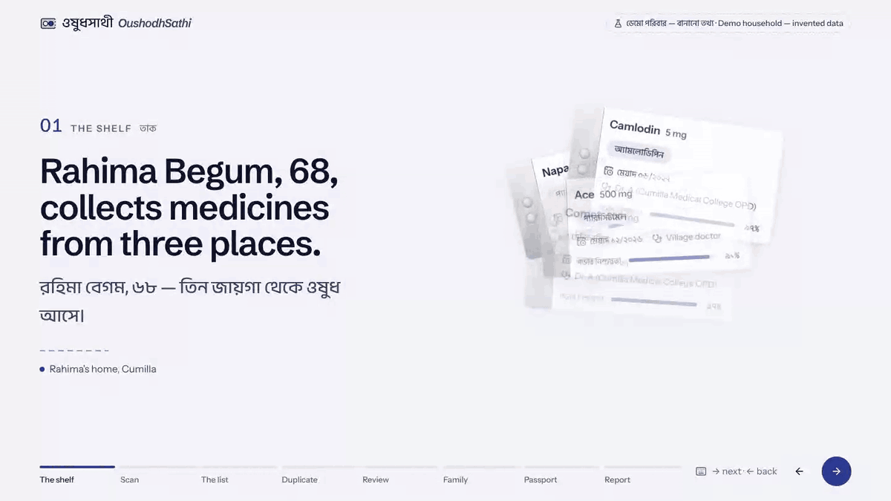
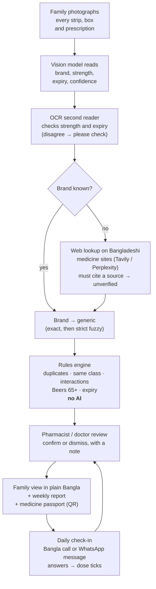
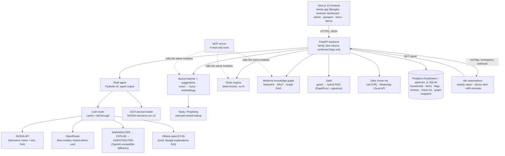

<picture>
  <source media="(prefers-color-scheme: dark)" srcset="docs/brand/banner-dark.svg">
  
</picture>

**A pharmacist for every elderly home in Bangladesh: we scan every medicine a parent takes, catch dangerous duplicates and interactions, and a clinician confirms every finding before the family sees it.**

[](https://github.com/ProttoyDip/OushodhSathi-/actions/workflows/ci.yml)
[](LICENSE)
[](backend/requirements.txt)
[](frontend/package.json)
[](#acknowledgements)

**Live demo:** <https://oushodhsathi.vercel.app> · **Docs:** [/docs](https://oushodhsathi.vercel.app/docs) · **Walkthrough:** [/demo](https://oushodhsathi.vercel.app/demo) · **Demo video:** [YouTube](https://youtu.be/a3wnCDDxxm0) · **Reviewer login:** [/review](https://oushodhsathi.vercel.app/review) asks for a name and a reviewer token; judges get the live token in the submission's Judge Access Note (locally, the quick start uses `demo-reviewer`). The hosted API runs on Render's free plan: it sleeps when idle, so the first request can take up to a minute. Data lives in a free Supabase Postgres, so households and reviews survive restarts. **Try it with your own family:** [/start](https://oushodhsathi.vercel.app/start) creates a private household that opens only with its family link.

<p align="center">
  
</p>

---

## The problem

- **Hypertension is now the most common illness in Bangladesh**, at 78.28 per 1,000 people (BBS Health and Morbidity Status Survey 2025, reported by [BSS](https://www.bssnews.net/others/337437) and [The Daily Star](https://www.thedailystar.net/health/disease/news/hypertension-most-common-illness-country-4047686)).
- **Only 11% of people with hypertension had their blood pressure controlled** below 140/90, a background figure in the [WHO-HEARTS evaluation in Bangladesh (Heart, 2024)](https://heart.bmj.com/content/heartjnl/early/2024/07/16/heartjnl-2024-324253.full.pdf).
- **69% of geriatric outpatients were prescribed five or more medicines** in a small 2011 study of 35 patients at a private hospital ([Trends of prescribing for out-door geriatric patients](https://www.academia.edu/111376182/Trends_of_prescribing_for_out_door_geriatric_patients_in_a_private_hospital_of_Bangladesh)).

An elderly patient often collects medicines from a hospital outpatient doctor, a village doctor and the local drug shop. Each sees only their own prescription, and the same molecule is sold under many brand names, so nobody notices that **Napa** and **Ace** are both paracetamol, or that two doctors have each started amlodipine.

## Features at a glance

| For | What they get |
| --- | --- |
| **Families** | Photograph every strip, box and prescription; a photo-quality warning before sending; a second OCR reader checks strength and expiry; "Is it one of these?" for unrecognised brands; only clinician-confirmed findings in plain Bangla; Today's medicines with pictures and Listen; a printable medicine passport with an emergency QR; before-the-visit page; blood pressure from a photo; Ramadan plans; a daily Bangla check-in by phone call or WhatsApp; export, link rotation and delete |
| **Pharmacists and doctors** | A personal invite login; a queue ordered by an explainable risk score; evidence side by side with keyboard shortcuts; a "Why?" knowledge-graph path for every finding; a cited AI case summary (Graph RAG); eGFR and kidney-dose checks; BP trend and adherence with confidence intervals; check-in history |
| **Everyone** | Sathi, an in-app helper that answers only from the app guide (hybrid keyword + vector search) and passes every medical question to a person; Bangla ⇄ English and light ⇄ dark on every page |
| **The team** | Reviewer invites and lost-link recovery at `/admin`; "results ready" and weekly emails; n8n alerts; scheduled jobs |
| **Judges and developers** | `/demo` walkthrough, a resettable invented household, `/docs` with live numbers, `/models`, an MCP server with four read-only tools, and evaluations for every model |

The full list, with where each feature lives in the app and the code and whether it is live, is in **[`docs/FEATURES.md`](docs/FEATURES.md)**. See also [Documentation](#documentation).

## How it works



Anything read with under 0.75 confidence, every web-found brand match, and every item where the OCR second reader saw a different strength or expiry is shown to a human for confirmation before it enters the list. Before sending, the scan page warns about blurry, glary, dark or tiny photos, and for a brand it does not recognise it offers "Is it one of these?" suggestions to tap.

**Sathi (সাথী), the in-app helper,** always shows the family the one next step (chosen by a state machine, not by AI), answers "how do I…" questions only from a written app guide, and passes every medical question to the pharmacist. Emergency words get a fixed "go to hospital or call 999" card with no AI involved. It takes voice input and reads answers aloud when the phone has a Bangla voice.

**Made for real families:**
- **Today's medicines** works without reading: morning, noon and night as pictures, the strip's own photo from this phone, and tablets drawn as shapes. A Listen button reads it out, and it prints as a fridge sheet. Only times a pharmacist approved appear.
- **Before the doctor visit** puts everything on one printable page: what changed since the last visit and who changed it, confirmed findings, four weeks of blood pressure, and the family's questions.
- **Set aside** lists expired strips and medicines the reviewer stopped, so nobody takes them by mistake.

**Elder-specific checks:** an **anticholinergic burden** rule adds up each medicine's score on the Anticholinergic Cognitive Burden scale (2012 update) and sends a total of 3 or more in a patient aged 65+ to the pharmacist, because it is linked to confusion, falls and memory problems. A **look-alike / sound-alike** rule catches two brands in one house whose names look or sound alike but contain different medicines (Jaro-Winkler similarity with a shared start, plus a phonetic key that knows "Ceclo" sounds like "Seclo"); it raises no false alarm across the whole seed brand table. Brand names written in **Bangla script** ("নাপা ৫০০ মিগ্রা" on a handwritten prescription) now match through a pharmacist-checked spelling table, and a cut-off fragment is never guessed. For the reviewer, the queue is ordered by an explainable **household risk score** (open findings, age, number of medicines and prescribers, anticholinergic burden; every point shows its reason), and a **blood-pressure trend** box gives the weekly change in systolic pressure with a 95% confidence interval. All of these are deterministic code with tests; none uses a language model.

**Kidneys, antibiotics and adherence.** A **triple whammy** rule catches an ACE inhibitor or ARB, a diuretic and an NSAID in the same house (a known cause of acute kidney injury in older adults; Medsafe NZ 2013, Lapi et al. BMJ 2013), counting combination tablets ingredient by ingredient. A reviewer can enter a **creatinine** result; the backend computes **eGFR with the 2021 CKD-EPI equation** (race-free) and the KDIGO stage, and a **kidney-dose** rule uses only sourced rows (metformin below eGFR 45 and 30, FDA 2016), with a **kidney-test-due** reminder when metformin has had no test in a year. Antibiotics carry their **WHO AWaRe** group (Access / Watch / Reserve) as a chip, and a Watch antibiotic from a drug shop or bought by the family, or any Reserve antibiotic, goes to the pharmacist or doctor; the family says where each medicine came from with one tap, and no model guesses it. On **Today's medicines** the family ticks each dose as taken or not taken (never advice to take it late or double it); the reviewer sees 14-day adherence per medicine with a 95% Wilson interval and how many expected doses were recorded at all. A **STOPP/START v3** engine is ready for criteria our pharmacist enters and verifies (START notes go to the doctor only, never to the family), and a reviewer-only checklist records pack and seller observations without ever calling a medicine fake.

**Chronic care:** combination medicines are checked ingredient by ingredient (Napa Extra and Ace are still paracetamol twice), and the rules cover the hypertension and diabetes pairs that matter most (a beta-blocker hiding low sugar with a sulfonylurea, a steroid raising sugar with metformin). **Same medicine, lower price** compares only identical generic, strength and form, never switches a brand, and sends the question to the pharmacist. **Ramadan:** the family asks, a pharmacist or doctor maps each medicine to sehri or iftar, and only then does Today's medicines change, with a fixed safety card on when to break the fast. **For siblings abroad:** a shared activity log and a Bangla + English WhatsApp digest with the read-only emergency link. **For judges:** a demo bar on `/demo`, `/p/1` and `/review` resets the demo household in about a second.

**Daily check-ins.** With recorded consent the family picks a time and a channel: a short **recorded Bangla phone call** (press 1 taken, 2 not taken, 9 emergency) or a **WhatsApp message** with buttons (one paid template a day, free follow-ups inside WhatsApp's 24-hour window). Answers become dose ticks for the pharmacist; 9 or the emergency button gives the fixed 999 message and alerts the family contact; no AI and no advice anywhere. Both run as browser simulators until a phone provider and a WhatsApp Business number are connected ([`docs/CHECKINS.md`](docs/CHECKINS.md)).

**For the reviewer, explanations come from a knowledge graph.** Every finding has a "Why?" path (Osartil Plus → losartan → ARB → raas group) with the source of each step, and the AI case summary is built only from numbered graph facts and must cite one in every sentence.

**Pilot-ready accounts and data rights.** Each pharmacist or doctor signs in with a personal invite link (only a hash of the token is stored, and every decision records who made it); the team manages invites at `/admin`. Families accept the privacy notice to start, and can rotate their private link, export everything and delete the household. On the pilot server photos go only to providers that do not keep them. Families who opt in get a "results ready" email and a weekly report.

**The passport** shows what each medicine is for (written by the pharmacist), allergies and who prescribed what. Its QR opens a read-only emergency page with no login and first name only; the family can renew or switch it off. **Blood pressure** can be read from a photo of the machine, and the family checks the numbers before saving. The confirmed list also exports as **FHIR R4**.

Every page has a **Bangla ⇄ English** switch and a **light / dark** switch. The family app is built for a phone first and spreads into a working desktop layout on a laptop; the reviewer dashboard collapses into Queue / Evidence / Patient tabs on small screens.

## Screenshots

<table>
  <tr>
    <td width="50%"></td>
    <td width="50%"></td>
  </tr>
  <tr>
    <td><b>Scan (family, phone).</b> Bangla first, one action per screen, tips for cut strips and glare.</td>
    <td><b>Confirmed result (family, phone).</b> Only clinician-confirmed findings appear, in plain Bangla.</td>
  </tr>
  <tr>
    <td></td>
    <td></td>
  </tr>
  <tr>
    <td><b>Reviewer dashboard (desktop).</b> Evidence side by side; J/K to move, C to confirm, D to dismiss, N to add a note.</td>
    <td><b>Medicine passport (print).</b> Grouped by time of day, carried to every doctor visit.</td>
  </tr>
</table>

All screenshots use the invented demo household of Rahima Begum, 68, Cumilla.

## Why it's safe

**AI for perception, rules and humans for judgement.** Models read photos and write explanations; they never decide what is dangerous.

1. **Rules make every finding.** Safety flags come only from the deterministic engine in [`backend/app/rules.py`](backend/app/rules.py). Language models never create, remove or change the severity of a flag.
2. **A clinician confirms before the family sees anything.** Flags start as `pending_review`. The family view of the API returns only `confirmed` flags, enforced in the API, not just the UI, and covered by a test.
3. **No instruction to stop or change a medicine.** No text tells a patient to stop, start or change a medicine or dose. Explanations are checked for doses and stop-words and end with a fixed safety sentence.
4. **Uncertain readings are marked.** Extractions under 0.75 confidence and web-found brand matches are always shown as needing human confirmation.
5. **Names stay out of models.** Only medicine photos and medicine names are sent to a model, never patient names or phone numbers.
6. **Photos are not kept.** Full uploaded photos (strips, boxes and prescriptions, including any prescription header with the patient's name) are processed in memory and discarded after extraction; nothing is stored on the server. For visual strip verification only, a photo of strips or boxes gets a small downscaled thumbnail, returned once and kept only in the family's browser. A photo with a prescription in it gets no thumbnail.

These rules live in [`AGENTS.md`](AGENTS.md) and bind every coding agent that works on this repository.

The public deployment is locked down as well. Each real household opens only with its private family link (a random key, checked in the API; anything else is "not found", so ids cannot be guessed). Photo reading is rate-limited per visitor and per day, because it spends AI credits. Only a signed-in reviewer can change which AI model everyone uses.

## Architecture



Locally the API uses a SQLite file. Hosted, it uses a free Supabase Postgres in a private schema (`DATABASE_URL`), so data survives restarts of the free Render instance; the same SQL runs on both ([`backend/app/store.py`](backend/app/store.py), [`docs/DEPLOY.md`](docs/DEPLOY.md)).

## AI approach

| Task | Model / provider | Why | Guardrail |
| --- | --- | --- | --- |
| Read photos of strips, boxes, prescriptions | NVIDIA API `nemotron-3.5-super-vl` first; then free OpenRouter vision models, auto-picked (price 0, image input, largest context) and each **tested with a one-token call before use**; up to three, then `openrouter/free`, then NARAROUTER → EXPLAB → AGENTROUTER | Cut strips, glare and Bangla text need a vision model; free models keep it affordable | Typed Pydantic output, one retry, then needs-review; confidence < 0.75 always shown for a human check |
| Unknown brand → generic | Tavily search restricted to medex.com.bd, arogga.com, medeasy.health + a text model; Perplexity Agent API (`effort: fast`) as fallback | Bangladesh has tens of thousands of brands; a seed table cannot hold them all | Must cite a numbered search result; stored as `web_unverified` with the source URL; failures are never cached |
| Bangla explanation of a confirmed finding | Ollama `qwen2.5:3b` locally first, cloud fallback, then fixed templates | Private and free when run locally | Only for confirmed flags; dose and stop-word filter; Bangla well-formedness check (a broken vowel sign sends it back to the template); fixed safety sentence |
| Sathi: app-guide answers and next-step wording | Ollama first (private), then the cloud chain; 8-second budget, else the guide's own answer | Warm, simple Bangla without a person writing every reply | Guard before and after every model call: emergency and injection words, medical intent (unsure counts as medical), output check for doses, stop/start wording, unknown medicine names and diagnoses; answers only from [`docs/help`](docs/help) |
| Sathi app-guide retrieval (contextual hybrid RAG) | Keyword (RapidFuzz) + vector (NVIDIA `nemotron-3.5-embed-1b`, 1024-d) fused by reciprocal rank fusion; vectors in Supabase Postgres with **pgvector** (HNSW, cosine), or in SQLite locally. Each guide entry gets a fixed context header (section, screen, questions in both languages) before embedding | Families ask in Bangla, Banglish and English; word matching alone misses paraphrases | guard.py runs first, so medical and emergency questions never reach retrieval; names are removed before embedding; without a key it is keyword-only. Measured on 79 questions ([`run_retrieval_eval.py`](eval/run_retrieval_eval.py)): recall@1 keyword 90%, vector 94%, hybrid 95% (95% CI 88-98%); 78 of the questions were drafted by the build agent and still need the team's review |
| Case summary for the reviewer (Graph RAG) | Text chain (NVIDIA first). v2 gets ONLY numbered facts from the medicine knowledge graph and the rule findings, and must cite one in every sentence; v1 is the fallback | Saves the pharmacist time on long lists | Facts only; any prescriber or medicine not in the record, advice, doses or diagnoses drop it; labelled "check the evidence", collapsed after 10 reviews; v2 also deletes any sentence without a valid fact id. On the demo household ([`run_case_summary_eval.py`](eval/run_case_summary_eval.py), 10 uncached runs each, free models): passed every check v1 8/10 (49%-94%), v2 8/10 (49%-94%), median 18 s vs 42 s. This measures safety-check pass rate and grounding, not usefulness, which needs pharmacists |
| Medicine knowledge graph | **No model.** NetworkX graph built only from the reference tables ([`medgraph.py`](backend/app/medgraph.py)): brand, generic, class, triple-whammy group, interaction, Beers, kidney, anticholinergic and AWaRe nodes, every edge carrying its source; snapshot in `kg_nodes` / `kg_edges` (Postgres or SQLite) | Shows the reviewer *why* a finding fired ("Why?" on each flag) and feeds the Graph RAG summary | Explains only: rules.py never imports it, and a test checks run_rules gives identical flags with it loaded. No graph database: about 160 nodes rebuild from the CSVs in well under a second, and free hosting has no room for Neo4j |
| Second reading of strength and expiry | NVIDIA `nemotron-ocr-v2` (PaddleOCR fallback), hosted ([`ocr_check.py`](backend/app/ocr_check.py)) | Misread strengths and expiry dates are the most likely real errors | Only compares: strengths and month-year dates in the OCR text against the vision reading; a disagreement marks the item "please check" with what it saw, never changes the reading or creates a finding; raw OCR text is not stored or logged; off without a key or when private vision excludes NVIDIA; [`run_eval.py`](eval/run_eval.py) reports its catch rate and false alarms once labelled photos exist |
| "Is it one of these?" for unrecognised brands | RapidFuzz whole-string spelling + NVIDIA `nemotron-3.5-embed-1b` embeddings, fused by reciprocal rank ([`brand_suggest.py`](backend/app/brand_suggest.py)) | Typos, cut-off names and other scripts defeat exact matching | Suggests at most three table brands; nothing is applied until the family taps one, which then goes through normal matching; the pharmacist still reviews; spelling-only without a key |
| Photo-quality warning before upload | **No model.** Image statistics in the browser: variance of the Laplacian (blur), near-white share (glare), mean (dark), short side (small) ([`photoQuality.ts`](frontend/src/lib/photoQuality.ts)) | A retake costs a second now, a misread costs a pharmacist's time later | The photo does not leave the phone for this; it only warns and never blocks; cautious thresholds still to be checked against the labelled eval photos |
| Read a blood-pressure monitor photo | Vision chain | Families type numbers wrong | Impossible values rejected; under 0.8 confidence the family confirms; the photo is not stored |
| Safety findings | **No model.** Deterministic rules | Judgement must be repeatable and auditable | Pure functions with tests; a clinician confirms every flag |
| Reviewer queue order, BP trend | **No model.** Explainable risk score; least-squares trend with a 95% CI | Reviewers see the riskiest household first; numbers, not opinions | Orders the queue only, never changes a flag; trend shown to reviewers only |
| Bangla voice input for Sathi | OpenAI Whisper large-v3 hosted by NVIDIA (Riva gRPC, offline mode); the browser's own speech recognition as fallback | Older users and families speak more easily than they type Bangla | Audio in memory only, never stored or logged; 30 s / 2 MB; the transcript lands in the text box to read and edit and is never sent automatically, so guard.py and name redaction run as for typed text; one-time privacy notice |
| Sathi intent classifier (escalate-only) | NVIDIA `nemotron-3.5-embed-1b` embeddings + logistic regression (coefficients only); BanglaBERT as an offline research comparison | Catches medical questions that slip past the word lists (Banglish, typos) | Runs after guard.py and can only move a question towards medical or emergency, never to app; off until 200+ human-written held-out examples pass [`run_intent_eval.py`](eval/run_intent_eval.py); [model card](eval/intent_model_card.md) |
| Missed-dose risk model | Gradient boosting on household-week features from the family's ticks | Helps a pharmacist decide whom to follow up first | Refuses to train without 30 real households and 300 household-weeks, never on demo data; AUROC with bootstrap CI and calibration; only a reviewer-only ordering hint, never a finding; [model card](eval/adherence_model_card.md) |
| Kidney function (eGFR) | **No model.** 2021 CKD-EPI creatinine equation | Several medicines need care when kidney function is low | Only creatinine is stored; every threshold row carries its source; findings are confirmed by a clinician |
| Daily Bangla check-in call (IVR) | **No model.** Fixed pre-recorded Bangla prompts and a small state machine ([`voice_calls/`](backend/app/voice_calls)) behind a provider interface (`place_call`, `parse_webhook`, `verify_signature`). Today only the **simulator** runs: [`/call-demo`](https://oushodhsathi.vercel.app/call-demo) plays the call in the browser with keys 1 / 2 / 9; no phone provider is connected yet | Many older patients have a basic phone, not a smartphone | Needs the family's recorded consent; the number is encrypted at rest and goes only to the call provider, never to a model; no calls 21:00-08:00, one retry after 15 minutes, a daily cap; answers become dose ticks marked `source=call`; 9 plays the fixed 999 message and alerts the family contact; the script never tells anyone to stop, start or change a medicine; draft Bangla audio is generated once by [`make_call_audio.py`](backend/scripts/make_call_audio.py) (digits spoken as words; Meta MMS-TTS, non-commercial licence, until an Azure bn-BD voice or a recording replaces it) and still needs a native speaker's check |
| Daily WhatsApp check-in message | **No model.** WhatsApp Cloud API ([`whatsapp_checkin/`](backend/app/whatsapp_checkin)): one approved utility template a day ("সব খেয়েছি / কিছু বাদ গেছে / জরুরি সমস্যা"), then free follow-ups inside WhatsApp's 24-hour customer-service window asking about each approved slot. Without WhatsApp keys a browser chat simulator runs the same conversation | Many families already use WhatsApp, and receiving the message costs them nothing | Same consent, time, quiet hours and stop switch as the call; the number is encrypted and goes only to WhatsApp (Meta); replies are matched to the message they answer, each delivery handled once, webhooks signature-checked; typed text is never stored or sent to a model, only emergency words get the fixed 999 reply; answers become dose ticks marked `source=whatsapp`. Needs a verified Meta business number and an approved template before real use |

**When a provider runs out, the next one answers.** Every request walks a chain: the user's chosen model first (if any), then NVIDIA's API (`nemotron-3.5-super-vl` for photos, `nemotron-3-ultra` for lookups and Bangla), then the tested free OpenRouter models, then the other configured routers, then Ollama on the machine. Rate limits (429), exhausted credit (402), withdrawn models, server errors and timeouts all fall through to the next link; nothing has to be switched by hand. Web lookup does the same with Tavily, then Perplexity.

**The models in use are visible, and the user can choose.** The **AI models** page (`/models`) shows each task's chain in order, which model answered last, and a picker to put a preferred model first; the rest stay as backups. The family's confirm screen says which model read the photos, and the reviewer sees the model and prompt version for every item.

Prompts are versioned files: [`extract_strip.v1`](backend/app/prompts/extract_strip.v1.md), [`brand_lookup.v1`](backend/app/prompts/brand_lookup.v1.md), [`explain_bn.v1`](backend/app/prompts/explain_bn.v1.md), [`sathi_bn.v1`](backend/app/prompts/sathi_bn.v1.md), [`sathi_intent.v1`](backend/app/prompts/sathi_intent.v1.md), [`sathi_nextstep.v1`](backend/app/prompts/sathi_nextstep.v1.md), [`case_summary.v1`](backend/app/prompts/case_summary.v1.md), [`case_summary.v2`](backend/app/prompts/case_summary.v2.md) (Graph RAG), [`read_bp.v1`](backend/app/prompts/read_bp.v1.md). Changing a prompt means a new version file and a new eval run.

## Evaluation

- **Extraction accuracy: evaluation in progress (n = 0 labelled photos).** Photos are labelled in the browser with [`backend/scripts/label_photos.py`](backend/scripts/label_photos.py) (a privacy checklist must be ticked for each photo). [`eval/run_eval.py`](eval/run_eval.py) then reports brand, strength and expiry accuracy and the needs-check rate, each with a 95% Wilson interval, a reliability table (stated confidence vs observed accuracy, to check the 0.75 cut-off), results per photo condition (cut strip, glare, Bangla print, handwritten), and with `--per-provider` each vision provider alone. Below 25 photos the results file, `/docs` and this README show only "evaluation in progress"; no accuracy number is claimed until then. See [`eval/README.md`](eval/README.md).
- **Sathi safety eval: 83 cases, no leaks.** [`eval/run_sathi_eval.py`](eval/run_sathi_eval.py) with the guard and guide retrieval alone (no model, as in CI): app questions answered from the right guide entry **34/35 (97%)**; medical questions sent to the pharmacist **33/33** (including Ramadan fasting questions); emergencies escalated **10/10**; rule-breaking attempts refused **5/5**. The one miss went to the pharmacist, the safe direction. The run fails CI if any medical or emergency question gets an app answer. The cases were written by the team and still need native-speaker review.
- **Review time: measured from the first decision.** Every finding records the time from a reviewer opening it to deciding it; `/docs` shows the median. This is the unit cost of a paid review.
- **Blood-pressure photos: not measured yet.** [`eval/run_bp_eval.py`](eval/run_bp_eval.py) is ready for labelled monitor photos; no accuracy is claimed until they exist.
- **Pilot: not started.** Each consenting household becomes one row in [`eval/pilot.csv`](eval/pilot.csv); the `/docs` page reports proportions with 95% Wilson confidence intervals from that file only. Demo data is never counted.
- **Tests: 399 passing** (`pytest` in `backend/`), covering the rules engine (including combination medicines and the hypertension and diabetes interactions), the same-medicine price comparison, Ramadan plans, the demo reset, the family-view safety gate, Sathi's guard and state machine, the case-summary checks, approved schedules and set-aside medicines, the emergency page, FHIR export, private household links, rate limits, blood-pressure validation, the database layer on SQLite and Postgres, router fallback and free-model probing, model choice, the explanation and Bangla-quality guards, the statistics, hybrid retrieval, the knowledge graph and Graph RAG citations, the OCR second reader, brand suggestions, both check-in channels (consent, quiet hours, retries, signatures, repeated webhook deliveries, export and delete), the eval scoring, and that the generated docs match the code. CI runs them on every push, with the frontend lint and build.

## Tech stack

| Layer | Tools |
| --- | --- |
| Frontend | Next.js 15 (App Router), React 19, TypeScript, Tailwind CSS 4, next-intl (Bangla + English), motion, Recharts, lucide-react |
| Backend | Python 3.12+, FastAPI, Pydantic 2, Pydantic-AI, RapidFuzz, NetworkX (knowledge graph), httpx, cryptography (encrypted phone numbers), SQLite / Postgres (psycopg 3) with pgvector |
| AI | NVIDIA API (Nemotron vision and text, `nemotron-3.5-embed-1b` embeddings, `nemotron-ocr-v2`, Whisper large-v3 via Riva), OpenRouter (free models), OpenAI-compatible fallback routers, Ollama (`qwen2.5:3b`), Tavily, Perplexity Agent API; scikit-learn for the gated models; Meta MMS-TTS / Azure Speech for the call prompts (generated once) |
| Messaging | WhatsApp Cloud API (daily check-in), Resend (email), a provider-agnostic call (IVR) interface with a browser simulator |
| Automation | n8n workflows (JSON in [`automations/`](automations)) |
| Agent interface | MCP server on the official `mcp` Python SDK |
| Testing and CI | pytest, ESLint, GitHub Actions |
| Hosting | Render (API, free plan), Supabase (Postgres, free) and Vercel (frontend), see [`docs/DEPLOY.md`](docs/DEPLOY.md) |

## Quick start

You need Python 3.12+, Node.js 20+ and git. The commands are for macOS / Linux; on Windows use `.venv\Scripts\` instead of `.venv/bin/`.

```bash
git clone https://github.com/ProttoyDip/OushodhSathi-.git
cd OushodhSathi-

# 1. Backend
cd backend
python3 -m venv .venv
.venv/bin/pip install -r requirements.txt
cp .env.example .env
sed -i.bak 's/^REVIEWER_TOKEN=.*/REVIEWER_TOKEN=demo-reviewer/' .env   # or edit .env by hand
.venv/bin/python scripts/seed_demo.py          # the invented demo household
.venv/bin/uvicorn app.main:app --port 8000     # API docs at http://localhost:8000/docs
```

```bash
# 2. Frontend, in a second terminal
cd OushodhSathi-/frontend
cp .env.example .env.local                     # NEXT_PUBLIC_API_URL=http://localhost:8000
npm ci
npm run dev                                    # http://localhost:3000
```

Open <http://localhost:3000> for the landing page, `/p/1` for the family app (the seed prints the demo household's id), `/review` for the reviewer dashboard (token `demo-reviewer`), `/models` for the AI models in use, `/demo` for the keyboard-paced walkthrough and `/call-demo` for the check-in simulator. The API's interactive reference is at <http://localhost:8000/docs>; the written one is [`docs/API.md`](docs/API.md).

With `DEMO_MODE=true` (the default) everything works without API keys: fixed templates replace model wording, keyword search replaces vectors, and the check-ins run as simulators. To read real photos, add your own keys to `backend/.env` (an OpenRouter key is enough). Every setting is listed in [`docs/CONFIGURATION.md`](docs/CONFIGURATION.md). **Never commit `.env`.**

Optional, for private Bangla explanations on your own machine:

```bash
ollama pull qwen2.5:3b
```

Run the checks the CI runs:

```bash
cd backend && .venv/bin/python -m pytest
cd frontend && npm run lint && npm run build
```

## Project structure

```text
backend/
  app/
    main.py              the FastAPI app: every endpoint (reference: docs/API.md)
    rules.py             the deterministic rules engine: the only place findings are made
    agent.py             photo reading (Pydantic-AI agent) · ocr_check.py  the OCR second reader
    brands.py            brand → generic matching · brand_suggest.py  "Is it one of these?"
    medgraph.py          the medicine knowledge graph ("Why?", Graph RAG facts)
    clinical.py          the reviewer's case summary (v1, Graph RAG v2) and BP-photo reading
    sathi.py, guard.py   Sathi and its guard · help_index.py, help_vectors.py, embeddings.py  hybrid RAG
    voice_calls/         daily check-in call: script, state machine, provider interface, simulator
    whatsapp_checkin/    daily WhatsApp check-in: flow, Cloud API client, service
    kidney.py, triage.py, stats.py, llm_router.py, store.py (SQLite / Postgres), prompts/ (versioned)
  data/                  reference tables (brands, interactions, Beers, ACB, AWaRe, kidney rules, ...)
  scripts/               seed_demo, index_help, label_photos, make_call_audio, create_whatsapp_template,
                         gen_docs, import_brands, import_ddinter, import_aware
  tests/                 pytest suite (399 tests)
frontend/                Next.js app: family app, reviewer dashboard, admin, passport, /docs, /demo
  public/audio/call/     the check-in call's Bangla prompts
mcp/                     read-only MCP server for Claude Desktop and other MCP clients
automations/             n8n workflows: weekly report, doctor alert, refill reminder
eval/                    evaluations and their results (strip reading, Sathi, retrieval, case summary, ...)
docs/                    FEATURES, API, CONFIGURATION, CHECKINS, DEPLOY; brand assets, screenshots, video
video/                   1920×1080 scenes and the recording script for the demo video
.github/workflows/       CI, keep-alive, weekly email, check-in cron
```

## Documentation

| Document | What is in it |
| --- | --- |
| [`docs/FEATURES.md`](docs/FEATURES.md) | Every feature, by who uses it, with where it lives in the app and the code, and whether it is live, a simulator, or ready but off |
| [`docs/API.md`](docs/API.md) | All 95 API endpoints with who may call each one (generated from the code) |
| [`docs/CONFIGURATION.md`](docs/CONFIGURATION.md) | Every setting, its default and what it does (generated from `backend/.env.example`) |
| [`docs/CHECKINS.md`](docs/CHECKINS.md) | How the daily phone call and WhatsApp message work, and how to switch each on for real |
| [`docs/DEPLOY.md`](docs/DEPLOY.md) | Hosting on Render, Supabase and Vercel |
| [`eval/README.md`](eval/README.md) | Running the evaluations and adding labelled photos |
| [`mcp/README.md`](mcp/README.md) | The MCP server and its tools |
| [`AGENTS.md`](AGENTS.md), [`DESIGN.md`](DESIGN.md), [`PRODUCT.md`](PRODUCT.md) | The safety rules every change follows, the design system, the product brief |
| [`SUBMISSION_UPDATES.md`](SUBMISSION_UPDATES.md) | The submission form's text, kept true to the code |

`docs/API.md` and `docs/CONFIGURATION.md` are generated by `python backend/scripts/gen_docs.py`, and a test fails if they fall behind the code.

## MCP server

[`mcp/server.py`](mcp/server.py) is a stdio [Model Context Protocol](https://modelcontextprotocol.io) server that lets an MCP client use the product's medicine logic. All four tools are read-only; they can never write a flag.

| Tool | What it does |
| --- | --- |
| `match_brand(brand)` | Maps a Bangladeshi brand to its generic and class (exact, then strict fuzzy). "Napa Extra" is never forced onto "Napa". |
| `lookup_unknown_brand(brand, strength)` | Searches Bangladeshi medicine sites (Tavily, then Perplexity), must cite a source, always marked `web_unverified`. Needs a key in `backend/.env`. |
| `check_medicines(items, age)` | Runs the deterministic rules on a list and returns findings marked "pending clinician review". |
| `explain_flag_path(generics)` | Numbered facts from the medicine knowledge graph around the given generics (class, triple-whammy group, interactions, Beers, kidney, anticholinergic, AWaRe), each with its source table. Explains links; never creates findings. |

Claude Desktop config (Settings → Developer → Edit config), with your own absolute paths:

```json
{
  "mcpServers": {
    "oushodhsathi": {
      "command": "/path/to/OushodhSathi-/backend/.venv/bin/python",
      "args": ["/path/to/OushodhSathi-/mcp/server.py"],
      "env": { "PYTHONIOENCODING": "utf-8" }
    }
  }
}
```

More in [`mcp/README.md`](mcp/README.md).

## Demo video

[](https://youtu.be/a3wnCDDxxm0)

Watch it on YouTube: <https://youtu.be/a3wnCDDxxm0>

The 2:58 video is planned second by second in [`docs/video/SHOTLIST.md`](docs/video/SHOTLIST.md), with the voiceover and captions in Bangla and English ([`captions.bn.srt`](docs/video/captions.bn.srt), [`captions.en.srt`](docs/video/captions.en.srt)). Seven 1920×1080 scenes live in [`video/scenes`](video/scenes) (stills in [`docs/video/stills`](docs/video/stills)), and the product footage comes from the keyboard-paced [`/demo`](https://oushodhsathi.vercel.app/demo) walkthrough. `cd video && npm install && node record.mjs` re-records every clip and stitches a silent draft cut for the voiceover.

## Limits

What is not built or not measured yet, so nothing on this page is read as more than it is:

- **Daily check-in calls run only as a browser simulator** ([`/call-demo`](https://oushodhsathi.vercel.app/call-demo)). No phone provider is connected. The Bangla audio prompts are a generated draft (Meta MMS-TTS, licensed for non-commercial use only) that a native speaker has not yet checked.
- **The daily WhatsApp message also runs only as a simulator.** No WhatsApp Business number is connected and the check-in template has not been submitted to Meta for approval ([`create_whatsapp_template.py`](backend/scripts/create_whatsapp_template.py) is ready).
- **Strip-reading accuracy is not measured.** The labelling tool and the eval are ready; no labelled photos exist yet, so no accuracy figure is claimed.
- **No pilot results.** [`eval/pilot.csv`](eval/pilot.csv) has no real households yet; every household on the demo site is invented.
- **Small reference tables.** About 30 brands, 6 interactions, 5 Beers entries and 2 kidney-dose rules, seeded for the demo and to be extended with a pharmacist. DDInter data is non-commercial only and is not imported.
- **Evaluation sets need human review.** 78 of the 79 retrieval questions and the Sathi cases were drafted by the build agent; a native speaker still needs to check them.
- **The case-summary eval measures safety, not usefulness.** It counts how often a summary passes every check; whether it saves a pharmacist time needs pharmacists. On free models the Graph RAG summary takes about 40 seconds.
- **Two models are switched off by design** until real data exists: the escalate-only intent classifier (needs 200+ human-written examples) and the missed-dose model (needs 30 real households).
- **Free hosting.** The API sleeps when idle, so the first request can take up to a minute.

## Roadmap

1. A pharmacist-verified brand table, replacing the demo seed with a licensed Bangladeshi drug database.
2. Full DDInter 2.0 interaction import, reviewed for medicines common in Bangladesh.
3. Partner pharmacies as scan points for families without a smartphone.
4. Connect the daily check-ins to a real phone provider and a WhatsApp Business number (both built and running as simulators; see [`docs/CHECKINS.md`](docs/CHECKINS.md)), with native-speaker-checked audio.
5. A pilot with families, with results published only once they are real.
6. Authenticity checks through DGDA or manufacturer verification codes. The app itself will never judge whether a pack is genuine.
7. STOPP/START v3 engine ready; criteria to be entered and verified by our pharmacist (O'Mahony et al., Eur Geriatr Med 2023, doi:10.1007/s41999-023-00777-y).

## Team

| | Name | Role | GitHub |
| --- | --- | --- | --- |
|  | Prottoy Saha Dip | Team lead · Backend and AI | [@ProttoyDip](https://github.com/ProttoyDip) |
|  | Suchismita Sarkar | Design and presentation | [@Suchi1806](https://github.com/Suchi1806) |
|  | Sakin | Frontend | [@Sakin542](https://github.com/Sakin542) |

## Data and licences

- **Code:** MIT, see [`LICENSE`](LICENSE).
- **DDInter 2.0** drug–drug interaction database, [CC BY-NC-SA 4.0](https://creativecommons.org/licenses/by-nc-sa/4.0/). Used for non-commercial prototype purposes with attribution; [`backend/scripts/import_ddinter.py`](backend/scripts/import_ddinter.py) imports its downloads. The repository ships only a small curated interaction seed.
- **AGS Beers Criteria** (American Geriatrics Society) as the clinical reference for the 65+ rules in [`backend/data/beers_seed.csv`](backend/data/beers_seed.csv).
- **"Medicinal Products in Bangladesh — A Dataset of Generic and Brand Names, Dosage Strengths, and Manufacturers"**, Md Mahmudur Rahman and Md M Khan, University of Dhaka, Mendeley Data, v1, 2024, [doi:10.17632/zhtvkny53n.1](https://data.mendeley.com/datasets/zhtvkny53n/1). Not redistributed here; [`backend/scripts/import_brands.py`](backend/scripts/import_brands.py) converts a local download, under the licence stated on the dataset page.
- **Brand seed** [`backend/data/brands_seed.csv`](backend/data/brands_seed.csv): demo data, **not pharmacist-verified**.
- **WHO AWaRe classification 2025** ([B09489](https://www.who.int/publications/i/item/B09489)) for antibiotic groups in [`backend/data/aware_2025.csv`](backend/data/aware_2025.csv): **CC BY-NC-SA 3.0 IGO, non-commercial.** The shipped file is a seed to verify; [`scripts/import_aware.py`](backend/scripts/import_aware.py) converts the official spreadsheet. A commercial service needs WHO's permission or another source.
- **Anticholinergic Cognitive Burden scale** (2012 update, Aging Brain Care) in [`backend/data/acb_seed.csv`](backend/data/acb_seed.csv): the scale's owners ask users to request permission; to be requested before commercial use.
- **STOPP/START version 3**: O'Mahony D et al., Eur Geriatr Med 2023;14(4):625-632, [doi:10.1007/s41999-023-00777-y](https://doi.org/10.1007/s41999-023-00777-y). Cited; criteria are entered and verified by our pharmacist, none are shipped.
- **Kidney rules**: 2021 CKD-EPI equation (National Kidney Foundation, NIDDK); metformin thresholds from the FDA Drug Safety Communication of 8 April 2016; triple whammy from Medsafe NZ (2013), Lapi et al. (BMJ 2013) and Harezlak et al. (Adv Ther 2022). Sources are in the code and in each data row.
- **Fonts:** Schibsted Grotesk, Anek Bangla, Instrument Sans and Hind Siliguri, all under the SIL Open Font License.

## Medical disclaimer

OushodhSathi is a pilot service, not a medical device. It does not give medical advice. Every finding is confirmed by a registered pharmacist or doctor before a family sees it. The demo household is invented.

## Acknowledgements

Built for the **International AI Builders Congress 2026** (HealthSphere AI → ChronicCare AI), with thanks to **CloudCamp Bangladesh** and **Daffodil International University**.

See also [`CONTRIBUTING.md`](CONTRIBUTING.md) and [`SECURITY.md`](SECURITY.md).
