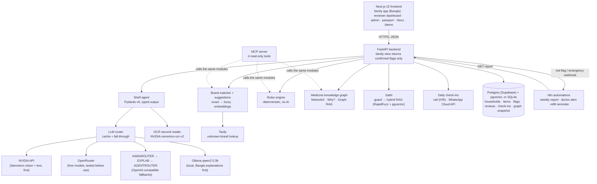

# Architecture

OushodhSathi is two applications: a **Next.js** frontend (the family app, the reviewer dashboard, the admin
page, the landing page and `/docs`) and a **FastAPI** backend that owns every rule, every model call and all data.
The frontend never talks to a model or a database directly.

## System



Locally the API uses a SQLite file. Hosted, it uses a free Supabase Postgres in a private schema (`DATABASE_URL`), so data survives restarts of the free Render instance; the same SQL runs on both ([`backend/app/store.py`](../backend/app/store.py), [`docs/DEPLOY.md`](DEPLOY.md)).

## Deployment

| Piece | Service | Notes |
| --- | --- | --- |
| Frontend | **Vercel**, project `oushodhsathi` | Builds only `frontend/`; `main` is production at <https://oushodhsathi.vercel.app>; every branch gets a preview |
| API | **Render**, `oushodhsathi-api` and `oushodhsathi-demo-api` | Free plan, deploys from `main`; sleeps when idle (first request up to a minute) |
| Database | **Supabase Postgres** with pgvector | A private schema, not exposed through Supabase's public REST API |
| Automations | **n8n** | Weekly report, red-flag doctor alert, refill reminder ([`automations/`](../automations)) |
| Scheduled jobs | **GitHub Actions** | CI on every push, keep-alive pings, weekly email, check-in cron |

Step-by-step setup is in [`DEPLOY.md`](DEPLOY.md); every setting is in [`CONFIGURATION.md`](CONFIGURATION.md).

## Data model

One SQL schema runs on both SQLite (local) and Postgres (hosted), in [`backend/app/store.py`](../backend/app/store.py):

| Table | Holds |
| --- | --- |
| `patients` | A household: first name, age, conditions, its private family key (a random token), consent |
| `items` | Each medicine read from a photo: brand, strength, expiry, generic, confidence, prompt and model version, who prescribed it |
| `flags` | Each finding from the rules engine: rule, severity, evidence, data source, status (`pending_review` / `confirmed` / `dismissed`) |
| `reviews` | Every reviewer decision, with who made it, the note and how long it took |
| `reviewers` | Pharmacists and doctors: name, role, registration number, a hash of their invite token |
| `dose_events` | "Taken / not taken" ticks from Today's medicines, calls and WhatsApp |
| `bp_readings`, `kidney_tests` | Blood pressure and creatinine (eGFR is computed, not stored) |
| `questions`, `activity`, `sathi_events`, `notifications` | Family questions to the pharmacist, the shared activity log, helper usage, sent emails |
| `call_schedules`, `call_attempts`, `wa_checkins`, `wa_messages`, `wa_inbound` | Daily check-ins by phone and WhatsApp; phone numbers encrypted |
| `cache` | Model responses keyed by prompt version, model and input, so the same photo is never paid for twice |

Photos are never stored (see [`SAFETY.md`](SAFETY.md)).

## The life of one scan

1. **Upload.** The family takes photos on `/p/{id}/scan`. The browser checks blur, glare, darkness and size first;
   nothing leaves the phone for that check.
2. **Read.** `POST /patients/{id}/scan` sends the photos to the shelf agent ([`agent.py`](../backend/app/agent.py)),
   which asks the model chain ([`llm_router.py`](../backend/app/llm_router.py)) for typed JSON: brand, strength,
   expiry, confidence. The OCR second reader compares strength and expiry. Photos are then discarded.
3. **Match.** Each brand goes through [`brands.py`](../backend/app/brands.py): an exact match on the curated seed
   or the 13,622-brand dataset, then a strict spelling match, then Bangla spellings. If nothing matches,
   [`brand_suggest.py`](../backend/app/brand_suggest.py) offers up to three "Is it one of these?" brands, and
   [`research.py`](../backend/app/research.py) can search Bangladeshi medicine sites (Tavily), marking the result unverified.
4. **Confirm the list.** The family checks the list; anything uncertain is marked and must be confirmed.
5. **Check.** [`rules.py`](../backend/app/rules.py) runs every rule on the confirmed items. New findings are `pending_review`.
6. **Review.** A pharmacist or doctor opens `/review`, sees the evidence, the rule, its source and the "Why?" path
   from the knowledge graph ([`medgraph.py`](../backend/app/medgraph.py)), and confirms or dismisses with a note.
7. **Tell the family.** Only confirmed findings reach the family, explained in plain Bangla
   ([`explain.py`](../backend/app/explain.py)), and on the printable passport.

## Code map

```text
backend/app/
  main.py              every API endpoint (reference: API.md, generated)
  rules.py             the rules engine: the only place findings are made
  agent.py             photo reading · ocr_check.py  the second reader · llm_router.py  the model chain
  brands.py            brand → generic · brand_suggest.py  suggestions · generic_names.py  salt names
  tables.py            loads the reference tables in backend/data
  medgraph.py          the medicine knowledge graph · clinical.py  case summary, BP photos
  sathi.py, guard.py   the in-app helper and its guard · help_index.py, embeddings.py  hybrid search
  voice_calls/, whatsapp_checkin/   the daily check-ins
  store.py             SQLite / Postgres · prompts/  versioned prompts
backend/data/          reference tables (see DATA.md)
frontend/src/app/      pages: (family)/p/[id]/..., (review)/review, admin, docs, demo, start, the landing page
frontend/messages/     every string in Bangla (bn.json) and English (en.json)
eval/                  evaluations and their results (see EVALUATION.md)
mcp/                   a read-only MCP server exposing the medicine logic
```
