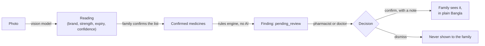

# Safety and privacy design

OushodhSathi handles elderly patients' medicines, so its central design decision is simple:
**AI for perception, rules and people for judgement.** Models read photos and help with wording. They never
decide what is dangerous, and nothing reaches a family until a registered pharmacist or doctor has confirmed it.

These rules are binding on every change to the code: they are written in [`AGENTS.md`](../AGENTS.md), which every
coding agent and contributor follows, and most are enforced by tests rather than by convention.

## The six rules

| # | Rule | Where it is enforced | Test |
| --- | --- | --- | --- |
| 1 | **Rules make every finding.** Safety findings come only from the deterministic rules engine. Language models never create, remove or change the severity of a finding. | [`backend/app/rules.py`](../backend/app/rules.py): pure functions over the confirmed medicine list | [`tests/test_rules.py`](../backend/tests/test_rules.py); `test_rules_are_identical_with_or_without_the_graph` in [`tests/test_medgraph.py`](../backend/tests/test_medgraph.py) |
| 2 | **A clinician confirms before the family sees anything.** New findings start as `pending_review`. The family's view of the API returns only `confirmed` findings; this is enforced in the API, not just hidden in the interface. | `GET /patients/{id}/flags` in [`main.py`](../backend/app/main.py) | `test_family_view_never_returns_pending_or_dismissed`, `test_family_status_never_exposes_pending_details` in [`tests/test_api.py`](../backend/tests/test_api.py) |
| 3 | **Never tell anyone to stop or change a medicine.** No text tells a patient to stop, start or change a medicine or dose. Explanations are checked for doses and stop-words and always end with a fixed sentence: *ডাক্তারের সাথে কথা না বলে কোনো ওষুধ বন্ধ বা পরিবর্তন করবেন না* ("Do not stop or change any medicine without talking to your doctor"). | [`backend/app/explain.py`](../backend/app/explain.py), [`guard.py`](../backend/app/guard.py) | [`tests/test_ai.py`](../backend/tests/test_ai.py), [`tests/test_sathi.py`](../backend/tests/test_sathi.py) |
| 4 | **Uncertain readings are marked.** A reading with confidence under 0.75, a brand found on the web, or a strength or expiry the second reader disagrees with is shown as "please check" and must be confirmed by a person. | `LOW_CONFIDENCE` in [`models.py`](../backend/app/models.py) | `test_low_confidence_and_unknown_items_need_review` in [`tests/test_api.py`](../backend/tests/test_api.py); [`tests/test_ocr_check.py`](../backend/tests/test_ocr_check.py) |
| 5 | **Names stay out of models.** Only medicine photos and medicine names are sent to a model, never patient names or phone numbers. Sathi removes names before embedding a question. | [`agent.py`](../backend/app/agent.py), [`sathi.py`](../backend/app/sathi.py) | `test_explanation_redacts_patient_name` in [`tests/test_ai.py`](../backend/tests/test_ai.py), `test_query_embeddings_use_query_type_and_redacted_text` in [`tests/test_hybrid_retrieval.py`](../backend/tests/test_hybrid_retrieval.py) |
| 6 | **Photos are not kept.** Uploaded photos are read in memory and discarded. A strip photo gets a small thumbnail returned once to the family's own browser; a photo with a prescription in it gets none. | [`agent.py`](../backend/app/agent.py), scan endpoint in [`main.py`](../backend/app/main.py) | `test_prescription_photos_get_no_thumbnail` in [`tests/test_chronic.py`](../backend/tests/test_chronic.py) |

## How a finding travels

An AI-written explanation is generated only after a clinician confirms a finding, only for that finding, and
falls back to a fixed template if it fails any check (doses, stop-words, broken Bangla).

## Sathi, the in-app helper

Sathi answers "how do I use the app" questions from a written guide ([`docs/help`](help)) and nothing else.

- **A guard runs before any model.** It checks every message for emergency words, prompt-injection attempts and
  medical intent (when unsure, it counts the message as medical).
- **Emergency words** get a fixed card ("call 999 or go to hospital"), with no AI involved.
- **Medical questions** go to the pharmacist and are never answered by the app.
- **Answers are checked after the model too**, for doses, stop/start wording and medicine names that are not
  in the record.
- **Measured** on 83 cases: medical questions 33/33 and emergencies 10/10 handled safely (see [`EVALUATION.md`](EVALUATION.md)).

## Daily check-ins (phone call and WhatsApp)

- **Consent:** the family's recorded consent is required.
- **Phone numbers** are encrypted at rest and go only to the call provider or WhatsApp, never to a model.
- **Scheduling:** no calls between 21:00 and 08:00, one retry, a daily cap, and a stop switch.
- **Answers** become "taken / not taken" ticks for the pharmacist. The script never advises anyone to take a
  dose late or double it.
- **Emergencies:** pressing 9, or the emergency button, plays a fixed 999 message and alerts the family contact.

Details in [`CHECKINS.md`](CHECKINS.md).

## Accounts and data rights

- **Households:** each opens only with its private family link, a random key checked by the API. Any other
  id returns "not found", so households cannot be enumerated.
- **Reviewers:** each pharmacist or doctor signs in with a personal invite link. Only a hash of the token is
  stored, and every decision records who made it.
- **Family controls:** families accept the privacy notice to start, and can rotate their link, export
  everything and delete the household.
- **Emergency QR:** the passport's QR code opens a read-only page with first name only, which the family can
  renew or switch off.
- **Limits:** photo reading is rate-limited per visitor and per day. Only a signed-in reviewer can change
  which AI model everyone uses.
- **Pilot mode** (`DEMO_MODE=false`): photos go only to providers that do not keep them, and the shared demo
  reviewer token stops working.

## Medical position

OushodhSathi is a pilot service, not a medical device, and it does not give medical advice. It helps a
pharmacist or doctor see a household's whole medicine shelf; the clinician makes every judgement. The demo
household (Rahima Begum, 68, Cumilla) is invented.
